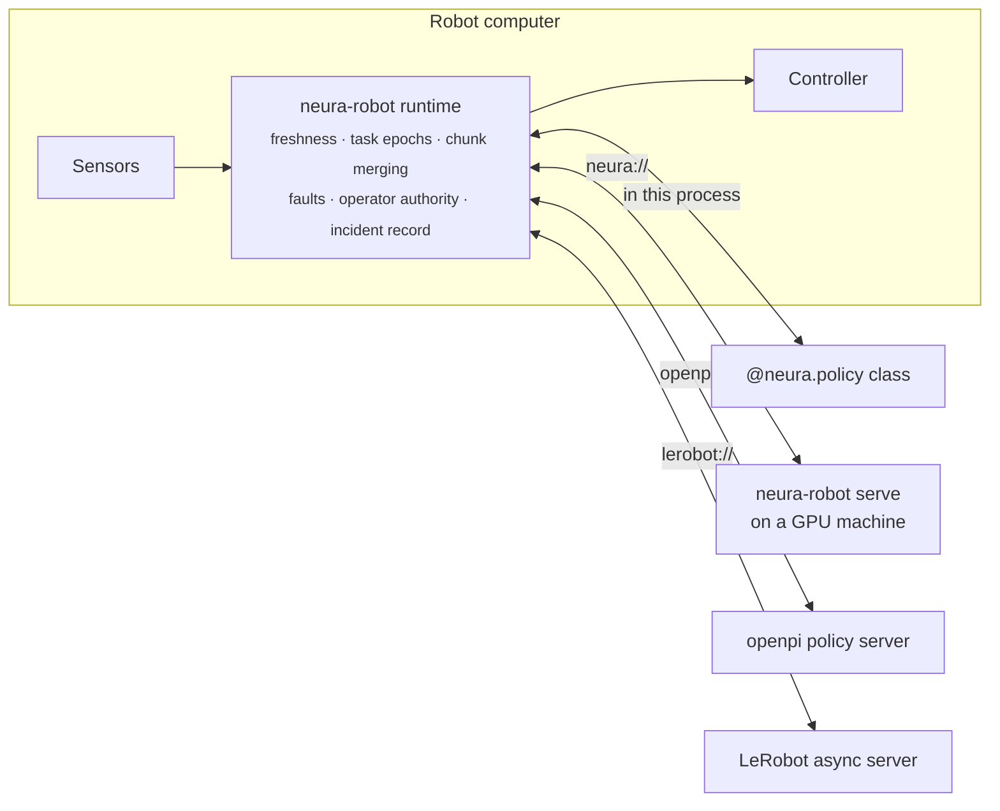

<div align="center">

# neura-robot

**One safety layer between any learned policy and any robot.**

Run a VLA or imitation policy on a real robot (in the robot's own process, on a GPU box down the
hall, or behind openpi or LeRobot) with the robot deciding what it executes, and a replayable
record of every decision when something goes wrong.

[](https://github.com/rkd0608/neura-robot/actions/workflows/ci.yml)
[](LICENSE)
[](pyproject.toml)
[](#project-status)

[Quickstart](#quickstart) · [Set up](#set-up-your-machine) · [Try it without hardware](#try-it-without-hardware) · [Bring your policy](#bring-your-policy) · [Safety model](#what-the-runtime-guarantees) · [Tests](#run-the-tests) · [Docs](docs/)

</div>

---

## Why

Getting a trained policy to move a real robot means writing the same code every team writes: a
policy server, a client, an action buffer, chunk blending, reconnects, timeouts. And then
debugging it at a customer site from logs that don't say why the arm did what it did.

The hard part isn't the network call. It's deciding, thirty times a second, whether an action is
still safe to execute: is the observation it was computed from too old? Was it computed for a task
the operator already took over? Did the policy server answer a different request? What does the
arm do when the answers stop?

**neura-robot is that decision layer, as a library.** The robot-side runtime is the execution
authority: every action passes its checks before it reaches the controller, whatever served it.



## Contents

- [Quickstart](#quickstart): one minute, nothing to install but Python
- [Set up your machine](#set-up-your-machine): every prerequisite, `make doctor`, Hugging Face
- [Try it without hardware](#try-it-without-hardware): simulated arms, the SO-101 emulator, a
  real robot's recording from Hugging Face, a remote policy, policy servers, ROS 2 and a
  Universal Robots arm in Docker, incident records
- [Run a real robot](#run-a-real-robot)
- [Bring your policy](#bring-your-policy)
- [What the runtime guarantees](#what-the-runtime-guarantees)
- [Run the tests](#run-the-tests)
- [Troubleshooting](#troubleshooting)
- [The repository](#the-repository), [Platforms](#platforms), [Status](#project-status),
  [Documentation](#documentation), [Contributing](#contributing)

## Quickstart

No robot, GPU or model download needed, just Python 3.10 or newer:

```bash
git clone https://github.com/rkd0608/neura-robot && cd neura-robot
python -m venv .venv && . .venv/bin/activate
pip install -e .
python examples/quickstart.py
```

A simulated arm runs an `@neura.policy` through the same runtime a real robot uses:

```
1. Connected. The runtime waits for an operator before anything moves.
  state Ready, commands sent to the arm: 0
2. Armed. The policy drives the arm at 30 Hz.
  state Running, commands sent: 60
  last command: [0.0, 0.0, 0.0, 0.0, 0.0, 50.0]
3. The policy starts failing. The arm runs out of fresh actions and the runtime stops.
  fault: STARVATION_GRACE_EXHAUSTED; response: controlled_stop
  commands after the fault: 0
4. The fault wrote an incident record. Replaying it through a fresh runtime:
  /tmp/neura-incidents-…/demo-arm-…-STARVATION_GRACE_EXHAUSTED.mcap
  712 events; replays the same: True

Open the record in Foxglove (https://foxglove.dev) to see every decision in time.
```

The number of events changes a little from run to run (it depends on this machine's timing);
"replays the same: True" doesn't.

## Set up your machine

Everything in this repository runs on one Linux or macOS machine without a robot or a GPU. Only
the core is required; each optional piece unlocks a part of the repository.

### 1. Prerequisites

| What | Needed for | Install |
|---|---|---|
| **Python 3.10+** (3.12+ for LeRobot) | everything | [python.org](https://www.python.org/downloads/), your package manager, or `uv python install 3.12` |
| **git** | cloning; the simulated arms' models | your package manager |
| **OpenGL for offscreen rendering** | the simulated arms' cameras | Debian/Ubuntu: `sudo apt-get install libegl1 libgl1`; macOS: nothing |
| **Docker** | openpi's server and ROS 2 Jazzy, in containers | [Docker Engine or Desktop](https://docs.docker.com/get-docker/) |
| **A Hugging Face account** (optional) | gated or private models and datasets | [huggingface.co/join](https://huggingface.co/join) |

[uv](https://docs.astral.sh/uv/) is optional but faster: replace `python -m venv .venv` with
`uv venv`, and `pip install` with `uv pip install`.

### 2. Install

```bash
git clone https://github.com/rkd0608/neura-robot && cd neura-robot
python3.12 -m venv .venv && . .venv/bin/activate   # 3.10 works for everything but LeRobot

make setup        # the core and the development tools: pip install -e ".[dev,openpi]"
make setup-all    # every extra this machine can run, with the right PyTorch (see below)
make assets       # fetch the simulated arms' models now (else on first use), about 100 MB
```

`make setup-all` adds MuJoCo and LeRobot (the SO-101 driver, the LeRobot server, recorded
robots), and picks the PyTorch LeRobot brings for this machine:

| Machine | PyTorch | Size |
|---|---|---|
| Linux, no NVIDIA GPU | the CPU build, from PyTorch's index | about 2 GB in all |
| Linux with an NVIDIA GPU (`nvidia-smi` works) | PyPI's, with CUDA | several GB more |
| Mac with Apple Silicon | PyPI's: CPU and Apple's GPU (Metal) | |
| Intel Mac, or Python before 3.12 | none: everything but LeRobot is installed, and it says why | |

Override the choice on Linux with `make setup-all TORCH=cpu` or `TORCH=cuda`; `python
scripts/setup.py --dry-run` prints what it would run.

Or pick extras yourself: `pip install -e ".[dev,openpi,sim]"`.

| Extra | Adds | Notes |
|---|---|---|
| `dev` | pytest, ruff, mypy and the type stubs | for working on the code |
| `openpi` | the `openpi://` transport | |
| `sim` | MuJoCo: the simulated arms and the ALOHA tasks | needs offscreen OpenGL |
| `so101` | LeRobot's Feetech servo driver: the SO-101 and its emulator | Python 3.12+ |
| `lerobot` | the `lerobot://` transport, and LeRobot itself | Python 3.12+ |

### 3. Check it

```bash
make doctor
```

Lists every capability (Python, extras, offscreen rendering, the arm models, Docker and the test
images, Hugging Face, network access) as ready or missing, with the command that fixes each
missing one.

### 4. Hugging Face

LeRobot policies and datasets live on the [Hugging Face Hub](https://huggingface.co/lerobot). The
`lerobot` and `so101` extras install `huggingface_hub` and its `hf` command.

```bash
hf auth login            # only for gated or private repositories; public ones need no account
export HF_HOME=~/hf      # optional: where models and datasets are cached (~/.cache/huggingface)
hf download lerobot/act_aloha_sim_transfer_cube_human     # e.g. fetch a public policy ahead
hf download --repo-type dataset lerobot/svla_so101_pickplace   # the recording the examples use
```

Behind a firewall or proxy, allow `huggingface.co` and `*.hf.co` (where the files are served
from). One test needs the Hub: the recorded SO-101 (86 MB, cached after the first run); the others
build small synthetic checkpoints.

## Try it without hardware

Each of these runs on a laptop. Start with the simulated arm; it shows the whole loop.

### A simulated arm: Franka Panda, UR5e, Kinova Gen3, xArm7 or SO-ARM100

Accurate models from [MuJoCo Menagerie](https://github.com/google-deepmind/mujoco_menagerie),
driven by `neura-arm` through the same runtime and robot process as a real arm:

```bash
pip install -e ".[sim]"
neura-arm run examples/robots/panda-sim.yaml
```

Type `arm` and the Panda waves (`examples/policies/panda_wave.py`); `status` prints where every
joint is; `takeover` stops the policy and holds; `quit` exits. Change `model:` to `ur5e`,
`kinova_gen3`, `xarm7` or `so_arm100` for another arm.

There are no contract files for these: the arm's robot profile is read from its model, and the
policy's contracts are inferred from what its `@neura.policy` declares, with limits from how fast
it runs on your machine. A policy that can't keep up, or whose chunks don't fit the arm, is
refused before the arm moves.

### An SO-101 on an emulated servo bus

LeRobot's real SO-101 driver, talking to an emulator of the arm's servo bus on a pseudo-terminal
(`so101` extra, Python 3.12+). In one terminal:

```bash
neura-arm-emulator --calibration-out examples/robots/calibration/so101-a.json
# prints the pseudo-terminal, e.g. /dev/pts/3: put it in examples/robots/so101-emulated.yaml
```

In another:

```bash
neura-arm run examples/robots/so101-emulated.yaml
```

Same commands: `arm`, `status`, `takeover`, `incident`, `quit`.

### A real robot's recording, from Hugging Face

An episode of a real SO-101's dataset on the Hugging Face Hub (its joint states and both camera
streams) played to the runtime and the policy at the speed it was recorded (`lerobot` extra):

```bash
neura-arm run examples/robots/so101-recorded.yaml
```

Everything but the arm moving in response (the commands change nothing: open loop). Type `arm`;
when the episode ends the runtime stops, as for a robot that went away, and `quit` prints how far
the policy's commands were from the actions recorded at the same moments, joint by joint. Point
`dataset:` at any LeRobot dataset whose joints match the robot profile.

### A policy on another machine

Serve any `@neura.policy` class over the network, and point a robot at it. On the GPU machine
(here, a third terminal):

```bash
neura-robot serve examples/policies/mid_range.py                   # loopback: no token needed
NEURA_SERVE_TOKEN=... neura-robot serve picker.py --listen 0.0.0.0:50061 --device cuda
```

On the robot (the emulated SO-101 above):

```bash
neura-arm run examples/robots/so101-emulated.yaml --policy neura://127.0.0.1:50061
```

Beyond loopback the server refuses to start without `NEURA_SERVE_TOKEN`, and robots send the same
token from their environment.

### openpi's and LeRobot's own policy servers

`openpi://` and `lerobot://` talk to those projects' servers, unmodified. To run them:

- **openpi**: follow [openpi's instructions](https://github.com/Physical-Intelligence/openpi) to
  serve a checkpoint (`scripts/serve_policy.py`), then `--policy openpi://gpu-box:8000` with an
  `openpi:` block naming its inputs ([docs/policies.md](docs/policies.md)). The test image
  `make test-docker` builds runs openpi's own server around a stand-in policy, with no GPU.
- **LeRobot**: `python -m lerobot.async_inference.policy_server --host=0.0.0.0 --port=8080`
  (the `lerobot` extra), then `--policy lerobot://gpu-box:8080` with a `lerobot:` block naming the
  policy type and checkpoint, a Hub name such as `lerobot/act_aloha_sim_transfer_cube_human`.

### ROS 2, in Docker

A simulated ROS 2 Jazzy arm in one container, the relay node in another, `neura-arm` on your
machine driving it while packets are dropped and the link is cut:

```bash
make test-docker      # builds the openpi and ROS 2 images and runs both scenarios
```

### A Universal Robots arm, through its own controller software

URSim, Universal Robots' simulator, runs the real UR controller software; Universal Robots'
official ROS 2 driver talks to it exactly as to an arm. `neura-arm` drives a UR5e through both:

```bash
make test-ursim       # builds the driver's image, boots URSim (about a minute), runs the scenario
```

To drive your own ROS 2 robot, including a UR arm, see [docs/ros2.md](docs/ros2.md).

### Incident records

Every robot above keeps the last ~30 seconds of what its runtime saw, was told and decided. A
fault, or typing `incident`, writes it to `incidents/` as [MCAP](https://mcap.dev):

```bash
neura-robot view incidents/<file>.mcap       # a page in your browser: a timeline and the story
neura-robot timeline incidents/<file>.mcap   # the story in words, in the terminal
neura-robot replay incidents/<file>.mcap     # a fresh runtime must decide exactly the same
```

`view` writes the page next to the record (`.html`, one file, nothing to install) and opens it:
the runtime's state, the policy's answers and your commands on one timeline, the fault, the
commands sent to the arm, and the story in words. See [docs/incidents.md](docs/incidents.md).

## Run a real robot

An SO-101 through LeRobot's servo driver (`so101` extra, Python 3.12+):

```bash
neura-arm check examples/robots/so101-arm.yaml --robot-profile examples/contracts/so101.robot.yaml
neura-arm run examples/robots/so101-arm.yaml --policy examples/policies/mid_range.py
```

`check` connects without moving anything and prints where every joint is. `run` waits for you:
type `arm` to start, `takeover` to stop the policy and hold, `incident` to save a record, `quit`
to exit.

ROS 2 robots work through a small relay node that runs on the robot's own ROS Python (Humble or
newer): see [docs/ros2.md](docs/ros2.md). Keep a hand on the e-stop the first time.

## Bring your policy

One runtime, four ways to reach the policy. Freshness, epochs, merging and faults behave the same
for all of them, and each passes the same end-to-end test.

| Where the policy runs | `--policy` | Notes |
|---|---|---|
| In the robot's process | `picker.py` | Any framework: an `@neura.policy` class |
| On another machine | `neura://gpu-box:50061` | `neura-robot serve picker.py` there; token required off loopback |
| openpi's policy server | `openpi://gpu-box:8000` | Unmodified server; map input names in the config |
| LeRobot's async server | `lerobot://gpu-box:8080` | Unmodified server; replies decoded without unsafe unpickling |

An `@neura.policy` is a class with an `act` method; bring weights from anything:

```python
import numpy as np
import neura_contracts.authoring as neura


@neura.policy(chunk_length=50, cameras={"front": (640, 480)})
class Picker:
    def __init__(self, weights, device):
        self.model = load_my_model(weights, device)

    def act(self, observation) -> np.ndarray:
        # observation["observation.state"], observation["observation.images.front"], ...
        return self.model(observation)  # (chunk_length, action features)
```

Before the arm is even connected, the policy is checked against the robot's contracts: a policy
whose chunks don't fit the robot never gets to start. See [docs/policies.md](docs/policies.md).

## What the runtime guarantees

- **Nothing moves until an operator arms it**, and `takeover` stops the policy at once.
- **No stale action executes.** Chunks computed from observations older than the execution
  profile allows are refused; actions already in the past are trimmed, never executed late.
- **No action from a finished task executes.** Every task has an epoch; a takeover, stop or reset
  starts a new one and fences everything in flight.
- **Answers are matched to their requests.** A late or mismatched reply is dropped, not
  mistaken for the current one, including on openpi's and LeRobot's wires, which carry no IDs.
- **Losing the policy is handled.** When fresh actions run out, the robot holds; past the grace
  period it faults, applies its fault response and latches until an operator resets it.
- **Out-of-range and non-finite actions never reach the controller.**

An independent invariant monitor (`neura_runtime.invariants`) checks these rules from outside the
runtime in every end-to-end test. Details: [docs/safety.md](docs/safety.md).

> neura-robot is not a safety-rated controller. It works *inside* the robot's own certified safety
> functions (e-stops, torque limits, safety-rated monitored stops), never instead of them.

## Run the tests

```bash
make check         # what CI runs on every Python: lint, types, tests, the quickstart
make test          # just the tests; every skipped test says what it needs
make test-docker   # openpi's own server and ROS 2 Jazzy under packet loss, in Docker
make help          # every task
```

| Tests | Run when | Needs |
|---|---|---|
| Runtime, contracts, transports, incident records | always | the core |
| Simulated arms and ALOHA | `sim` installed | offscreen OpenGL; git for the models |
| SO-101 driver against the emulated bus | `so101` installed | Python 3.12+ |
| A real SO-101's recording through the runtime | `lerobot` installed | the dataset from the Hugging Face Hub (86 MB, once) |
| LeRobot's own async server | `lerobot` installed | Python 3.12+ |
| openpi's own server, ROS 2 Jazzy | `make test-docker` | Docker, with `NET_ADMIN` allowed |
| A UR5e through URSim and the official UR driver | `make test-ursim` | Docker; about 6 GB of images |

`pytest packages/neura-runtime` runs one package; `pytest -k incident` runs by name. Tests treat
warnings as errors, and the timing-sensitive ones assume the machine isn't busy with something
else. CI runs `make check` on Python 3.10 to 3.13 on x86-64 and arm64, the extras on 3.12, the
Docker tests, and an install of the built wheel from scratch.

## Troubleshooting

| Symptom | Fix |
|---|---|
| `MUJOCO_GL=egl, but libEGL is not installed` | `sudo apt-get install libegl1 libgl1`, or `export MUJOCO_GL=osmesa` with `libosmesa6` |
| `fetching the Menagerie models needs git`, or the fetch fails | install git; offline, clone [mujoco_menagerie](https://github.com/google-deepmind/mujoco_menagerie) elsewhere and `export NEURA_MENAGERIE=/path/to/it` |
| `cannot drive this robot: a pass takes ... ms` | the policy is too slow for its chunk length on this machine: longer chunks, or a faster device |
| LeRobot won't install | it needs Python 3.12+: make the virtual environment with `python3.12` |
| `401` or `403` from Hugging Face | `hf auth login`, and accept the model's terms on its Hub page if it is gated |
| Hugging Face or GitHub unreachable | allow `huggingface.co`, `*.hf.co` and `github.com` through your proxy or firewall |
| Docker tests skipped | start Docker, `make test-docker` (it builds the images and sets their variables) |
| The ROS 2 test fails to drop packets | Docker must allow `--cap-add NET_ADMIN` (rootless Docker may not) |
| Timing tests fail on a busy machine | run them alone; they assume the CPU isn't shared with a heavy job |

Still stuck? `make doctor`, then [open an issue](https://github.com/rkd0608/neura-robot/issues/new/choose)
with its output.

## The repository

| Path | What it is |
|---|---|
| `packages/neura-runtime` | the runtime, policy transports, incident records (`neura_runtime`) |
| `packages/neura-robots` | robots: SO-101 and its emulator, ROS 2 (`ros2/`: the relay node), simulated arms (`sim/`), recordings (`recorded.py`), the robot process |
| `packages/neura-contracts` | contract documents and their compatibility check (`neura_contracts`) |
| `packages/neura-proto` | the wire protocol, generated from `proto/neura/v1` |
| `examples/` | contracts, robot configurations, example policies, the quickstart |
| `scripts/` | `make setup-all` (`setup.py`) and `make doctor` (`doctor.py`) |
| `docs/` | the documentation |

## Platforms

| | |
|---|---|
| Python | 3.10, 3.11, 3.12, 3.13 (LeRobot extras: 3.12+) |
| OS | Linux on x86-64 and arm64 (tested in CI on both; not yet on a Jetson); macOS for development |
| Robots | SO-101 (LeRobot driver), ROS 2 position-controlled arms (tested on Jazzy; the relay is written for Humble's Python 3.10 too), Universal Robots e-Series through the official driver (tested on URSim), simulated: Franka Panda, UR5e, Kinova Gen3, xArm7, SO-ARM100, ALOHA |
| Policy servers | `neura-robot serve`, openpi, LeRobot async inference |

## Project status

**Alpha.** The runtime's safety rules are tested end to end on emulated and simulated robots, over
real policy servers and lossy networks. They have not yet been qualified on production hardware;
APIs may change before 1.0. What's planned is in the [roadmap issue](https://github.com/rkd0608/neura-robot/issues/3)
and [CHANGELOG.md](CHANGELOG.md#roadmap).

neura-robot is the open-source core of Neura by NucleiLabs, which adds the site layer for fleets:
shared GPU serving, rollouts with shadow tests and rollback, and on-site data capture.

## Documentation

| | |
|---|---|
| [Quickstart and concepts](docs/README.md) | Contracts, the runtime's states, how a request becomes an action |
| [Configuration](docs/configuration.md) | `neura-arm` configuration files, field by field |
| [Policies](docs/policies.md) | `@neura.policy`, `neura-robot serve`, openpi and LeRobot |
| [Safety model](docs/safety.md) | What the runtime guarantees, and what it doesn't |
| [Incident records](docs/incidents.md) | Recording, the MCAP layout, replay |
| [ROS 2](docs/ros2.md) | The relay node and ROS 2 robots |
| [Development](docs/development.md) | Working on neura-robot: layout, tests, regenerating the protocol |

## Contributing

Issues and pull requests are welcome: see [CONTRIBUTING.md](CONTRIBUTING.md), and
[good first issues](https://github.com/rkd0608/neura-robot/labels/good%20first%20issue) to start
with. Security reports go privately through [SECURITY.md](SECURITY.md).

## License

[Apache-2.0](LICENSE). Copyright 2026 NucleiLabs. The simulated arms' models are MuJoCo
Menagerie's, under their own licenses (Apache-2.0 or BSD-3-Clause), fetched, never bundled.
