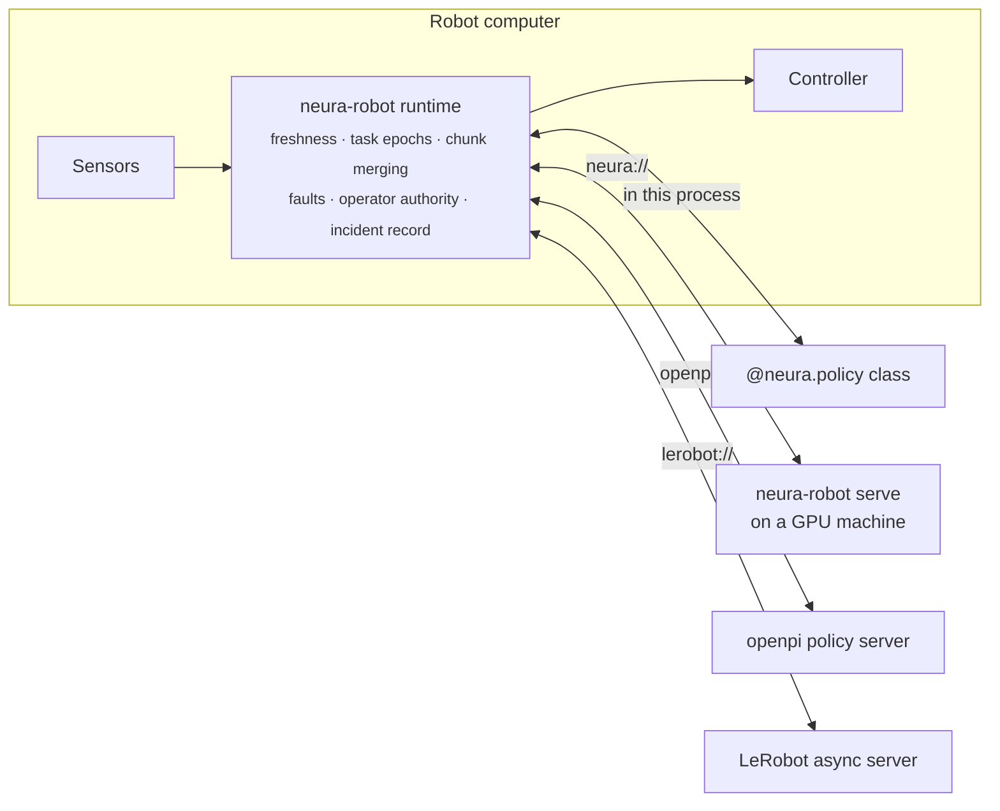

<div align="center">

# neura-robot

**One safety layer between any learned policy and any robot.**

Run a VLA or imitation policy on a real robot — in the robot's own process, on a GPU box down the
hall, or behind openpi or LeRobot — with the robot deciding what it executes, and a replayable record
of every decision when something goes wrong.

[](https://github.com/rkd0608/neura-robot/actions/workflows/ci.yml)
[](LICENSE)
[](pyproject.toml)
[](#project-status)

[Quickstart](#quickstart) · [Bring your policy](#bring-your-policy) · [Safety model](#what-the-runtime-guarantees) · [Incident records](#incident-records) · [Docs](docs/) · [Contributing](CONTRIBUTING.md)

</div>

---

## Why

Getting a trained policy to move a real robot means writing the same code every team writes: a
policy server, a client, an action buffer, chunk blending, reconnects, timeouts — and then debugging
it at a customer site from logs that don't say why the arm did what it did.

The hard part isn't the network call. It's deciding, thirty times a second, whether an action is
still safe to execute: is the observation it was computed from too old? Was it computed for a task
the operator already took over? Did the policy server answer a different request? What does the arm
do when the answers stop?

**neura-robot is that decision layer, as a library.** The robot-side runtime is the execution
authority: every action passes its checks before it reaches the controller, whatever served it.



## Quickstart

No robot, GPU or model download needed — just Python 3.10 or newer:

```bash
git clone https://github.com/rkd0608/neura-robot && cd neura-robot
python -m venv .venv && . .venv/bin/activate
pip install -e .
python examples/quickstart.py
```

A simulated arm runs an `@neura.policy` through the same runtime a real robot uses:

```
1. Connected. The runtime waits for an operator before anything moves.
  state Ready, commands sent to the arm: 0
2. Armed. The policy drives the arm at 30 Hz.
  state Running, commands sent: 60
3. The policy starts failing. The arm runs out of fresh actions and the runtime stops.
  fault: STARVATION_GRACE_EXHAUSTED; response: controlled_stop
  commands after the fault: 0
4. The fault wrote an incident record. Replaying it through a fresh runtime:
  709 events; replays the same: True
```

## Run a real robot

An SO-101 arm through LeRobot's servo driver (Python 3.12+, LeRobot's requirement):

```bash
pip install -e ".[so101]"
neura-arm check examples/robots/so101-arm.yaml --robot-profile examples/contracts/so101.robot.yaml
neura-arm run examples/robots/so101-arm.yaml --policy examples/policies/mid_range.py
```

`check` connects without moving anything and prints where every joint is. `run` waits for you:
type `arm` to start, `takeover` to stop the policy and hold, `incident` to save a record, `quit` to
exit. No hardware? `neura-arm-emulator` emulates the arm's servo bus on a pseudo-terminal.

ROS 2 robots work too, through a small relay node that runs on the robot's own ROS Python — see
[docs/ros2.md](docs/ros2.md).

## Bring your policy

One runtime, four ways to reach the policy. Freshness, epochs, merging and faults behave the same
for all of them, and each passes the same end-to-end test.

| Where the policy runs | `--policy` | Notes |
|---|---|---|
| In the robot's process | `picker.py` | Any framework: an `@neura.policy` class |
| On another machine | `neura://gpu-box:50061` | `neura-robot serve picker.py` there; token required off loopback |
| openpi's policy server | `openpi://gpu-box:8000` | Unmodified server; map input names in the config |
| LeRobot's async server | `lerobot://gpu-box:8080` | Unmodified server; replies decoded without unsafe unpickling |

An `@neura.policy` is a class with an `act` method — bring weights from anything:

```python
import numpy as np
import neura_contracts.authoring as neura


@neura.policy(chunk_length=50, cameras={"front": (640, 480)})
class Picker:
    def __init__(self, weights, device):
        self.model = load_my_model(weights, device)

    def act(self, observation) -> np.ndarray:
        # observation["observation.state"], observation["observation.images.front"], ...
        return self.model(observation)  # (chunk_length, action features)
```

Before the arm is even connected, the policy is checked against the robot's contracts — a policy
whose chunks don't fit the robot never gets to start. See [docs/policies.md](docs/policies.md).

## What the runtime guarantees

- **Nothing moves until an operator arms it**, and `takeover` stops the policy at once.
- **No stale action executes.** Chunks computed from observations older than the execution
  profile allows are refused; actions already in the past are trimmed, never executed late.
- **No action from a finished task executes.** Every task has an epoch; a takeover, stop or reset
  starts a new one and fences everything in flight.
- **Answers are matched to their requests.** A late or mismatched reply is dropped, not
  mistaken for the current one — including on openpi's and LeRobot's wires, which carry no IDs.
- **Losing the policy is handled.** When fresh actions run out, the robot holds; past the grace
  period it faults, applies its fault response and latches until an operator resets it.
- **Out-of-range and non-finite actions never reach the controller.**

An independent invariant monitor (`neura_runtime.invariants`) checks these rules from outside the
runtime in every end-to-end test. Details: [docs/safety.md](docs/safety.md).

> neura-robot is not a safety-rated controller. It works *inside* the robot's own certified safety
> functions (e-stops, torque limits, safety-rated monitored stops), never instead of them.

## Incident records

Every robot keeps the last ~30 seconds of what its runtime saw, was told and decided. When a fault
latches — or the operator types `incident` — that becomes an [MCAP](https://mcap.dev) file you can
open in [Foxglove](https://foxglove.dev) or Rerun, and replay:

```bash
neura-robot replay incidents/arm-1-20261031T120000-STARVATION_GRACE_EXHAUSTED.mcap
# arm-1-…mcap: replays the same (709 events: 60 commanded, 1 fault, …)
```

A fresh runtime fed the record's inputs must make exactly the same decisions, so every incident in
the field can become a regression test. Images are off by default and nothing leaves the machine.
See [docs/incidents.md](docs/incidents.md).

## Platforms

| | |
|---|---|
| Python | 3.10, 3.11, 3.12, 3.13 (LeRobot extras: 3.12+) |
| OS | Linux on x86-64 and arm64 (tested in CI on both; not yet on a Jetson) |
| Robots | SO-101 (LeRobot driver), ROS 2 position-controlled arms (tested on Jazzy; the relay is written for Humble's Python 3.10 too), simulated ALOHA (MuJoCo) |
| Policy servers | `neura-robot serve`, openpi, LeRobot async inference |

## Project status

**Alpha.** The runtime's safety rules are tested end to end on emulated and simulated robots, over
real policy servers and lossy networks. They have not yet been qualified on production hardware;
APIs may change before 1.0. What is planned next is in [CHANGELOG.md](CHANGELOG.md#roadmap).

neura-robot is the open-source core of Neura by NucleiLabs, which adds the site layer for fleets: shared GPU serving, rollouts with shadow tests and rollback, and on-site data
capture.

## Documentation

| | |
|---|---|
| [Quickstart and concepts](docs/README.md) | Contracts, the runtime's states, how a request becomes an action |
| [Configuration](docs/configuration.md) | `neura-arm` configuration files, field by field |
| [Policies](docs/policies.md) | `@neura.policy`, `neura-robot serve`, openpi and LeRobot |
| [Safety model](docs/safety.md) | What the runtime guarantees, and what it doesn't |
| [Incident records](docs/incidents.md) | Recording, the MCAP layout, replay |
| [ROS 2](docs/ros2.md) | The relay node and ROS 2 robots |
| [Development](docs/development.md) | Running the tests, including Docker and hardware-free ones |

## Contributing

Issues and pull requests are welcome — see [CONTRIBUTING.md](CONTRIBUTING.md). Security reports go
privately through [SECURITY.md](SECURITY.md).

## License

[Apache-2.0](LICENSE). Copyright 2026 NucleiLabs.
