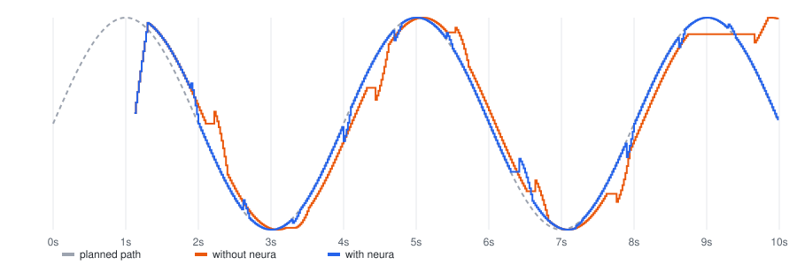

# With and without neura-robot

The same policy drives the same simulated arm (MuJoCo Menagerie's SO-ARM100) through two loops,
under the same conditions:

- **without neura**: the loop most teams write first, and LeRobot's own synchronous loop. When its
  queue of actions is empty it takes an observation, waits for the policy, then sends the chunk's
  actions one per control period, from the first;
- **with neura**: the same policy through neura-robot's runtime, under contracts written for a GPU
  server answering in about 100 ms.

Each condition decides, for every request, how long the policy takes to answer and what goes
wrong, so both loops meet exactly the same policy. Time is simulated: the arm's physics steps once
per control period (50 Hz) and answers arrive when the condition says, so every run is
deterministic. The policy is scripted: from each observation it plans 50 actions along a smooth
path, starting from where it saw the arm, as a trained policy plans from what it saw. What is
measured does not depend on what it plans. Rerun it with `python -m neura_robots.compare`.

## What each loop sent the arm

A command is *late* when it reaches the arm after the moment it was planned for: the arm is acting
on the past. "More than 0.25 s late" counts commands planned for a moment at least a
quarter of a second gone.

| Condition | Loop | Commands more than 0.25 s late | Latest command | Longest pause | How it stopped | Record of why |
|---|---|---|---|---|---|---|
| Steady GPU server | without neura | 0 of 401 | 100 ms | 140 ms | ran to the end | no |
|  | **with neura** | 0 of 444 | 100 ms | 120 ms | ran to the end | yes |
| Latency spikes | without neura | 17 of 367 | 880 ms | 920 ms | ran to the end | no |
|  | **with neura** | 0 of 439 | 100 ms | 120 ms | ran to the end | yes |
| Network drop | without neura | 50 of 378 | 640 ms | 680 ms | ran to the end | no |
|  | **with neura** | 0 of 415 | 100 ms | 600 ms | ran to the end | yes |
| Policy crash | without neura | 0 of 200 | 100 ms | 140 ms | the policy failed: the loop ended | no |
|  | **with neura** | 0 of 225 | 100 ms | 1040 ms | fault: STARVATION_GRACE_EXHAUSTED | yes |
| Operator takeover | without neura | 0 of 178 | 100 ms | 140 ms | the operator took over | no |
|  | **with neura** | 0 of 194 | 100 ms | 120 ms | the operator took over | yes |
| SmolVLA on a CPU (measured) | without neura | 151 of 151 | 2180 ms | 2200 ms | ran to the end | no |
|  | **with neura** | 0 of 0 | — | 9000 ms | held the arm: no answer was fresh enough | yes |

What this shows:

- **With a steady GPU server, both loops are fine.** The plain loop's commands are all about one
  answer time (80-120 ms) late, which a well-tuned robot tolerates; neura's are on time, but for
  its first chunk, played from its first action because the arm stood still while it waited.
- **When answers come late (latency spikes, a network drop, a slow model), the plain loop
  executes the past.** It plays every chunk from its first action whenever it arrives: commands
  planned for half a second to seconds ago. neura drops the actions whose moment has passed,
  refuses answers older than its contracts allow, and holds the arm until a fresh one comes.
- **A crash or a takeover** stops both loops; neura also faults, holds, and leaves a record of
  why (`neura-robot timeline`, `neura-robot view`).

## The arm under latency spikes

One joint's commands against the path the policy planned (1 answer in 8 takes 0.5-0.9 s (a busy GPU, garbage collection, a congested link)). The plain
loop stalls while it waits, then replays old plans; neura stays on the plan.



## A real model on real frames

[SmolVLA](https://huggingface.co/lerobot/smolvla_base) (Hugging Face's 450M-parameter
vision-language-action model) driving a real SO-101's recorded cameras and joints
([`lerobot/svla_so101_pickplace`](https://huggingface.co/datasets/lerobot/svla_so101_pickplace))
through neura-robot, on x86_64 CPU (Linux).

- **Its answer time, measured**: 2.19 s, 1.73 s, 1.95 s, 2.00 s, 2.16 s, 1.92 s, 1.62 s, 1.76 s, 1.96 s, 1.97 s, 1.97 s, 2.05 s (median 1.97 s). Each answer
  is a chunk of 50 actions, 1.7 s of motion at 30 Hz: by the time it arrives, its camera frame is
  older than the motion it plans.
- **Under the SmolVLA SO-101 contracts** (written for a GPU: an answer at most 150 ms old, a
  request abandoned after 200 ms), neura sent the arm **0 commands** in
  8 s: 8 requests ran out their time and no answer was used.
  The model also took the machine's cores from the robot's own sensing: 176 times the camera frames were too old to build an observation from, so none was sent. A model on the robot's own computer competes with it.
- **Contracts derived from its measured time**: neura refuses to start before the arm moves: a pass takes 2191 ms for 1 robot(s), so the next chunk would have to be asked 223 actions early, but a chunk has only 50: use a faster GPU, fewer robots per GPU, or a model with longer chunks.
- **Without neura**, the condition "SmolVLA on a CPU (measured)" in the table above: every chunk
  runs about 2.0 s behind what it was planned for.

```
   0.00s  state: Disconnected
   0.00s  operator: instruction "pink lego brick into the transparent box"
   0.00s  connected to the policy
   0.00s  state: Ready
   0.07s  operator: arm
   0.07s  new task (epoch 1)
   0.07s  state: Armed
   0.26s  the policy gave no answer: WORKER_TIMED_OUT  x8 over 1.34s
         0 actions sent to the arm; policy answers: 0 accepted, 0 refused, 8 not given; 0 faults
```

## Limits of this comparison

- The arm is simulated and the policy scripted: these numbers are about timing and safety, not
  about how well a model does a task.
- The plain loop is a fair copy of the common pattern, not of every loop: LeRobot's asynchronous
  inference, for one, overlaps waiting and acting, and is compared separately.
- The latencies are modelled on a GPU server (about 100 ms, with the spikes and the drop above)
  except where measured.
