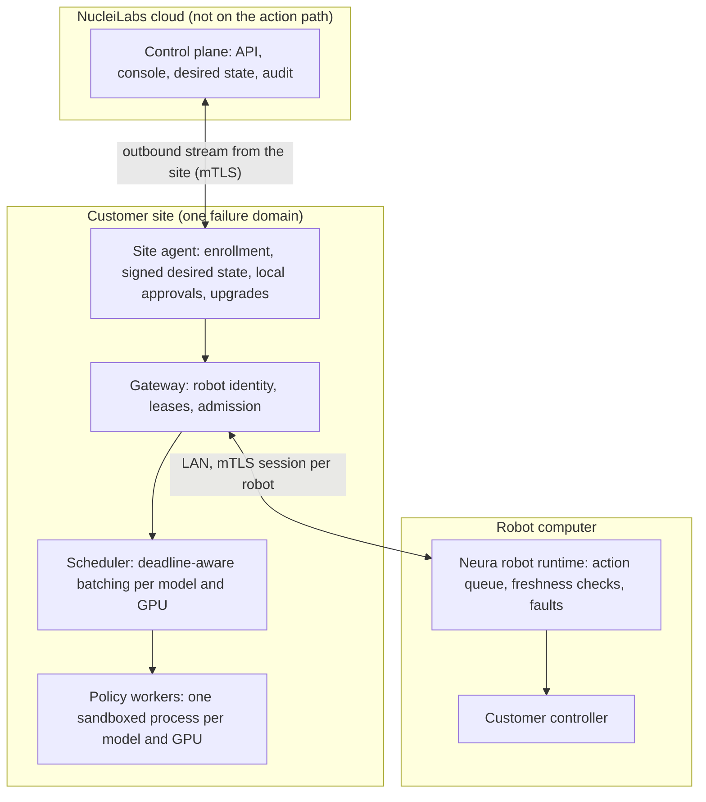

# Architecture

Neura has three parts: a runtime on each robot computer, a site agent and data plane on the
site's GPU servers, and a control plane in the cloud. Inside a site, components are separate
processes with protobuf interfaces even on one machine, so growing from one server to many is a
deployment change.

## On the robot

The **robot runtime** is the only execution authority. It keeps the robot's queue of future
actions, sends observations, and checks every action chunk that comes back: it must answer the
latest request, belong to the current task and serving session, come from a fresh enough
observation, and contain only actions inside the robot's declared ranges. If chunks stop
arriving, the robot runs its declared starvation response (for example hold position) and then
faults. A fault is latched: only an explicit local reset clears it, never a reconnection or a
command from the cloud.

An **integration adapter** connects the runtime to the customer's controller and sensors.

## On the site's GPU server

- The **site agent** enrolls the server with a one-time token, keeps an outbound connection to the
  control plane, verifies the signed desired state it receives, prepares models (verifying their
  digests and publisher signatures), asks a local operator to approve physical activation, and
  supervises the data plane.
- The **gateway** authenticates robots with certificates from the site's own CA, grants each robot
  a lease with a generation number that only increases, and refuses a session it could not serve
  in time (admission control).
- The **scheduler** batches requests from robots that run the same model on the same GPU, ordered
  by each robot's deadline.
- **Policy workers** run the model, one process per model and GPU, in a container with no network
  access. A worker computes chunks; it never decides what runs.

## In the cloud

The **control plane** serves the management API and the web console: organizations, projects,
sites, robots, models, execution profiles, deployments and revisions, operations, audit. It sends
desired state to sites and receives their status, under a [published schema](./reference/outbound.md).

## When the cloud is unreachable

Robots keep being served: nothing on the action path depends on the cloud. The site keeps running
its current deployment for as long as its offline authorization lasts (set per site), and
reconnects by itself. Changes such as a new revision wait for the connection. The robot's own
checks do not depend on any other machine's clock.
